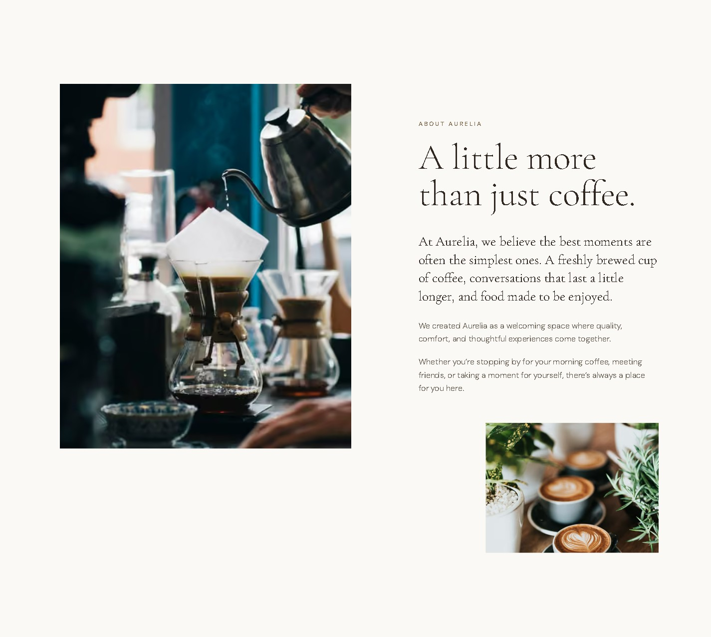
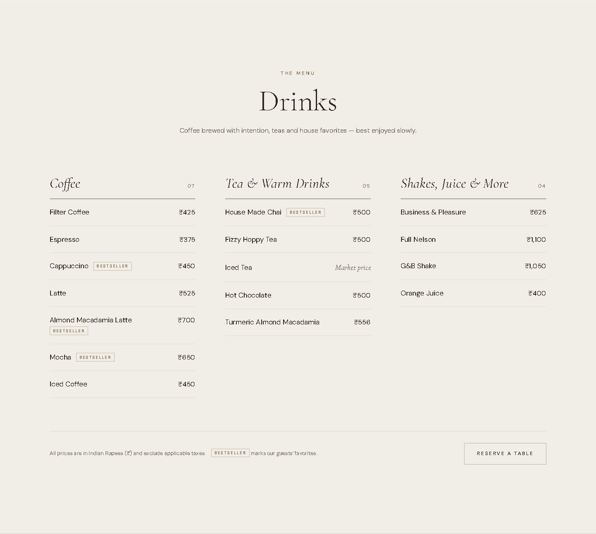
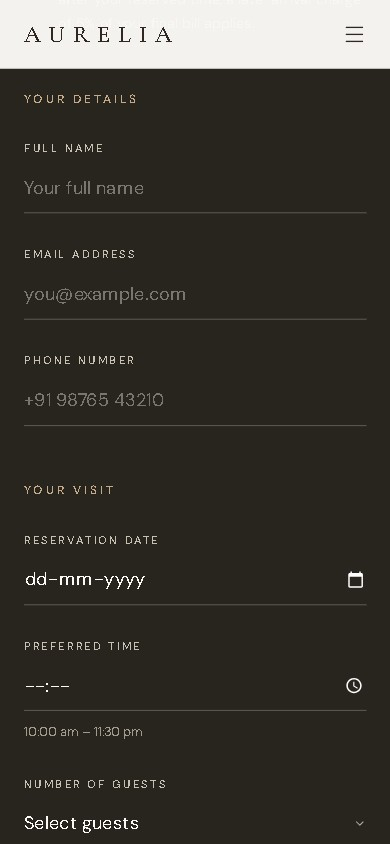
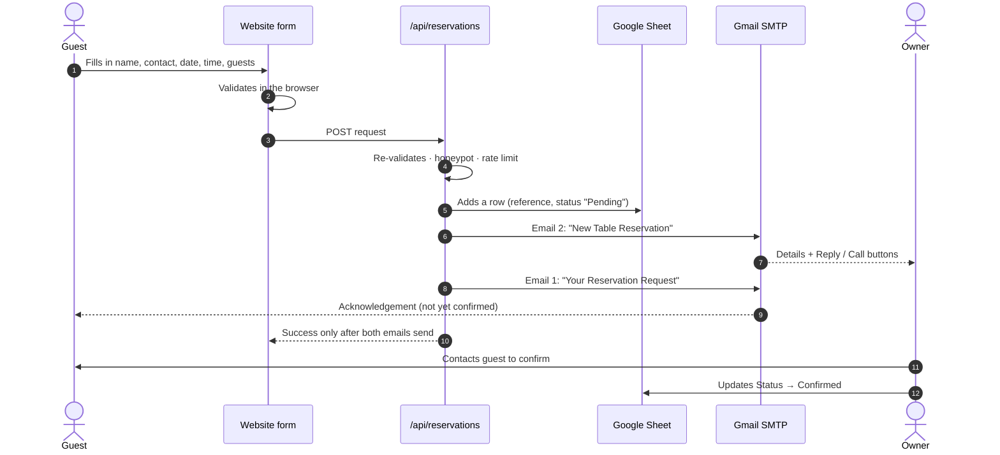

<div align="center">


<br><br>

# A U R E L I A

### *Where every cup tells a story.*

A premium, fully responsive website for a café in **Sindhu Bhavan, Ahmedabad**, with real table reservations that send emails and save to Google Sheets.

<br>


<br>

[**Features**](#-features) · [**Screenshots**](#-screenshots) · [**How it works**](#-how-a-reservation-works) · [**Quick start**](#-quick-start) · [**Email setup**](#-gmail-setup) · [**Sheets setup**](#-google-sheets-setup) · [**Customize**](#-customizing-the-content)

</div>

<br>

---

## ✦ Features

<table>
<tr>
<td width="33%" valign="top">

### 🎨 Editorial design
Modern minimalist luxury: Cormorant Garamond with DM Sans, a warm cream-and-espresso palette, asymmetric layouts and generous whitespace.

</td>
<td width="33%" valign="top">

### 📅 Real reservations
A validated form with loading, success and error states and protection against double submits. Success is shown **only** after the emails are actually sent.

</td>
<td width="33%" valign="top">

### ✉️ Two automatic emails
The guest gets a branded acknowledgement. The owner gets every detail, with one-click **Reply** and **Call** buttons.

</td>
</tr>
<tr>
<td valign="top">

### 📊 Google Sheets log
Every request becomes a row with a reference number and a **Status** dropdown (Pending → Confirmed → Completed).

</td>
<td valign="top">

### ☕ Data-driven menu
All 16 drinks with ₹ prices and bestseller labels come from one file. Add a food section and it appears automatically.

</td>
<td valign="top">

### 📱 Responsive & accessible
Designed for phone, tablet and desktop. Semantic HTML, keyboard navigation, visible focus, alt text and reduced-motion support.

</td>
</tr>
<tr>
<td valign="top">

### 🔎 SEO ready
Metadata, Open Graph and Twitter cards, a sitemap, robots.txt and structured data for a café (`CafeOrCoffeeShop`).

</td>
<td valign="top">

### ⚖️ Legal pages
`/privacy-policy` and `/terms-and-conditions` match how the site actually works and fill in from the café's settings.

</td>
<td valign="top">

### 🛡️ Secure by default
Credentials stay on the server. Input is validated on both client and server, with a spam honeypot, rate limiting and HTML-escaped emails.

</td>
</tr>
</table>

<br>

## ✦ Screenshots

<table>
<tr>
<td width="50%"></td>
<td width="50%"></td>
</tr>
<tr>
<td align="center"><sub><b>About</b> · asymmetric editorial layout</sub></td>
<td align="center"><sub><b>Menu</b> · aligned ₹ prices and bestseller labels</sub></td>
</tr>
</table>


<p align="center"><sub><b>Reservations</b> · validated request form with policies shown up front</sub></p>

<br>

<div align="center">
<table>
<tr>
<td></td>
<td></td>
<td></td>
</tr>
<tr>
<td align="center"><sub>Mobile hero</sub></td>
<td align="center"><sub>Navigation</sub></td>
<td align="center"><sub>Reservation form</sub></td>
</tr>
</table>
</div>

<details>
<summary><b>View the "Made to be savored." section</b></summary>
<br>

</details>

<br>

## ✦ How a reservation works



> [!NOTE]
> A submission is a reservation **request**, not a confirmed booking. The guest is told this on the form, on the success screen and in their email.
> If the Google Sheet can't be reached, the emails still go out, and the owner email shows a red note so the row can be added by hand.

<br>

## ✦ Quick start

```bash
npm install
cp .env.example .env.local     # then fill in the values below
npm run dev                    # → http://localhost:3000
```

| Command | Description |
|:--|:--|
| `npm run dev` | Start the development server |
| `npm run build` · `npm start` | Production build · serve it |
| `npm run typecheck` | TypeScript check |
| `npm run test:email` | Log in to Gmail SMTP and send one test email to yourself |
| `npm run test:sheet` | Add one test row to the Google Sheet |

> Requires **Node.js 20.9+**.

### Environment variables

| Variable | Required | Description |
|:--|:--:|:--|
| `GMAIL_USER` | ✅ | Gmail address that **sends** the emails |
| `GMAIL_APP_PASSWORD` | ✅ | 16-character Google App Password (not your normal password) |
| `OWNER_EMAIL` | ✅ | Inbox that **receives** new requests |
| `SMTP_PORT` | — | `465` (SSL, default) or `587` (STARTTLS) |
| `GOOGLE_SHEETS_WEBHOOK_URL` | — | Apps Script web app URL (ends in `/exec`). Leave empty to turn the sheet off |
| `GOOGLE_SHEETS_SECRET` | — | Shared secret, which must match `SECRET` in the Apps Script |
| `NEXT_PUBLIC_SITE_URL` | — | Public URL, used for SEO and social previews |

> [!IMPORTANT]
> `.env.local` is git-ignored. Never commit real credentials.

<br>

## ✦ Gmail setup

<details>
<summary><b>Step-by-step: create an App Password and send a test email</b></summary>

<br>

1. **Turn on 2-Step Verification** at <https://myaccount.google.com/security>. App Passwords only exist on accounts that have it.
2. **Create an App Password** at <https://myaccount.google.com/apppasswords>. Name it `Aurelia website`, click **Create**, and copy the 16-character password. Google shows it only once.
3. **Add it to `.env.local`:**
   ```ini
   GMAIL_USER=the-sending-account@gmail.com
   GMAIL_APP_PASSWORD=abcd efgh ijkl mnop   # spaces are fine
   OWNER_EMAIL=owner@example.com
   ```
4. **Test it** with `npm run test:email`. You should see `✓ Logged in…` and receive a test email.
5. Restart `npm run dev` and submit the form with your own address. **Both** emails should arrive.

**Troubleshooting**
- *"Invalid login" / 535:* you used your normal password or copied the App Password wrong. Create a new one.
- *App Passwords page unavailable:* 2-Step Verification is off, or a work/school admin has disabled it.
- *Sending limits:* a personal Gmail account can send about 500 emails a day. Each reservation uses 2.

</details>

<br>

## ✦ Google Sheets setup

<details>
<summary><b>Step-by-step: connect a sheet in about 5 minutes</b></summary>

<br>

1. **Create a sheet** at <https://sheets.new> (for example `Aurelia Reservations`).
2. **Extensions → Apps Script.** Replace everything in `Code.gs` with [`scripts/google-apps-script.gs`](scripts/google-apps-script.gs).
3. **Set the secret.** Paste the value of `GOOGLE_SHEETS_SECRET` from `.env.local` into `const SECRET = "…"`, then click **Save**.
   *Need a secret?* Run `node -e "console.log(require('crypto').randomBytes(24).toString('base64url'))"`
4. **Deploy → New deployment → Web app**
   - Execute as: **Me**
   - Who has access: **Anyone** (the secret stops anyone else from adding rows)
   - Click **Authorize**. If you see "unverified app", click **Advanced → Go to …**. It's your own script.
5. **Copy the Web app URL** (ends in `/exec`) into `GOOGLE_SHEETS_WEBHOOK_URL`.
6. Run `npm run test:sheet`, then delete the test row it adds.

| Reference | Submitted (IST) | Status | Name | Email | Phone | Date | Time | Guests | Special requests |
|:--|:--|:--|:--|:--|:--|:--|:--|:--:|:--|
| `AUR-7KQ2XD` | 2026-11-19 18:42 | Pending ▾ | … | … | … | 2026-11-28 | 19:30 | 2 | … |

> [!TIP]
> After editing the script, go to **Deploy → Manage deployments → ✏️ → New version**. Saving alone doesn't update the live web app, and the URL stays the same.

</details>

<br>

## ✦ Customizing the content

Everything business-specific lives in **two files**, so the site can be rebranded quickly.

| What | Where |
|:--|:--|
| Menu items, prices, bestsellers, new sections (e.g. food) | [`data/menu.ts`](data/menu.ts) |
| Concept banner (turn off for a real café) | [`data/site.ts`](data/site.ts) → `demo.enabled` |
| Name, contact details, address, map coordinates | [`data/site.ts`](data/site.ts) → `contact`, `location` |
| Opening hours and last booking time | [`data/site.ts`](data/site.ts) → `hours` |
| Guest limit, booking window | [`data/site.ts`](data/site.ts) → `reservations` |
| Cancellation, late-arrival and tax policy | [`data/site.ts`](data/site.ts) → `legal` |
| Colors and type | [`app/globals.css`](app/globals.css) → `@theme` |
| Photography | [`public/images/`](public/images) (keep file names, or update the imports) |

<details>
<summary><b>Design system</b></summary>

<br>

| Token | Hex | Use |
|:--|:--|:--|
| Cream | `#FAF9F6` | Primary background |
| Sand | `#F1EEE8` | Secondary background |
| Espresso | `#302820` | Primary text |
| Stone | `#81786E` / `#6F665C` | Secondary text (the darker shade passes WCAG AA) |
| Accent | `#A58A6A` / `#7E6548` | Lines and decoration / small accent text |
| Roast | `#28251F` | Dark sections and footer |

**Type:** Cormorant Garamond (display) · DM Sans (body), loaded with `next/font`.
**Motion:** hero entrance, scroll-linked reveals (progressive enhancement), and `prefers-reduced-motion` respected.

</details>

<br>

## ✦ Project structure

```
app/
├── page.tsx                    Home: all sections
├── layout.tsx                  Fonts, metadata, Open Graph
├── globals.css                 Design tokens + component styles
├── api/reservations/route.ts   Validate → Sheet → Emails
├── privacy-policy/             /privacy-policy
├── terms-and-conditions/       /terms-and-conditions
└── sitemap.ts · robots.ts · icon.svg · not-found.tsx
components/                     Navbar · Hero · About · FeaturedItems · Menu
                                Reservation · Contact · Footer · LegalPage
data/
├── menu.ts                     Menu & prices (single source of truth)
└── site.ts                     Business settings
lib/
├── validation.ts               Shared client/server validation
├── mailer.ts                   Gmail SMTP (server-only)
├── email-templates.ts          HTML + plain-text emails
└── sheets.ts                   Google Sheets via Apps Script
scripts/
├── google-apps-script.gs       Paste into the Google Sheet
├── test-email.mjs              SMTP check
└── test-sheet.mjs              Sheet check
docs/screenshots/               Images used in this README
```

<br>

## ✦ Deploying

Deploy to [Vercel](https://vercel.com/new) (recommended for Next.js) or any Node.js host:

1. Push the repository to GitHub. `.env.local` is excluded automatically.
2. Import it in Vercel.
3. Add every variable from `.env.local` under **Settings → Environment Variables**, with `NEXT_PUBLIC_SITE_URL` set to your live domain.
4. Deploy, then submit a test reservation on the live site.

<br>

## ✦ Before launch

- [x] Gmail SMTP connected and tested
- [x] Google Sheets connected and tested
- [x] Map coordinates · opening hours · cancellation, late-arrival and tax policy
- [ ] Street address (optional): `location.exactAddress`
- [ ] Hosting provider: `legal.hostingProvider` (Privacy Policy)
- [ ] How long reservation records are kept: `legal.retentionPeriod` (Privacy Policy)
- [ ] Review the Privacy Policy and Terms, then set `legal.showDraftNotice` to `false`

<br>

## ✦ Security & privacy

- SMTP and sheet credentials are read **only on the server** (`server-only` imports) and never reach the browser.
- All input is re-validated on the server, and user text is HTML-escaped in emails and protected against spreadsheet formulas in the sheet.
- A hidden honeypot field and a per-IP limit (5 requests / 10 minutes, in memory) reduce spam. For high traffic, use a shared store instead.
- No analytics or advertising cookies.

<br>

## ✦ Credits

Photography from [Unsplash](https://unsplash.com), used under the Unsplash License. Replace it with the café's own photos when available.
Icons by [Lucide](https://lucide.dev) · Fonts from [Google Fonts](https://fonts.google.com).

<br>

<div align="center">

**AURELIA**
<br>
<sub>Good coffee. Good food. Good moments.</sub>
<br><br>
<sub>© 2026 Aurelia. All rights reserved.</sub>

</div>
